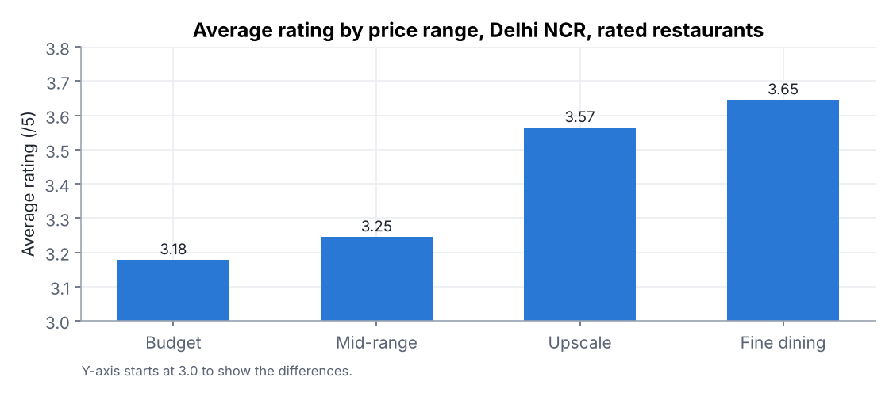
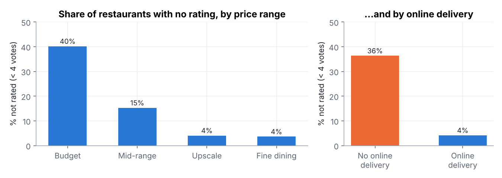
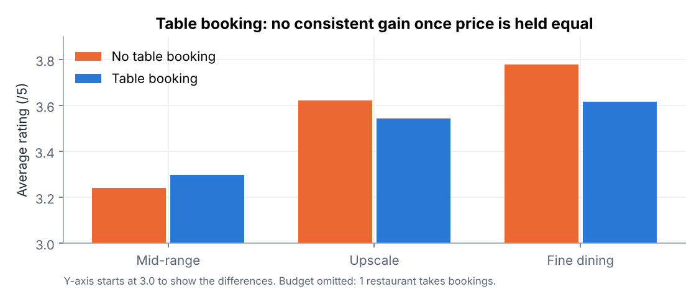
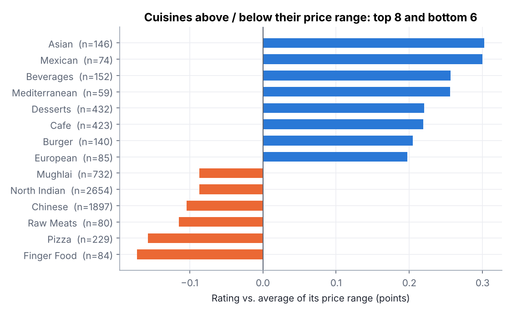

# What drives a restaurant's rating on Zomato? Delhi NCR

Data analysis project by **Atsou Paul LOLO** · [Portfolio](https://paul-lolo.netlify.app/) · [LinkedIn](https://www.linkedin.com/in/paul-lolo-960610234/)

**Business question:** for a restaurant owner, an investor or Zomato's sales team, which factors (price, cuisine, location, online delivery, table booking) go with a better rating and more visibility?

**Tools:** Python (pandas, matplotlib) · data cleaning · exploratory analysis · confounding control

➡️ **Full analysis with code and charts: [`analysis.ipynb`](analysis.ipynb)**

## Data
Kaggle *Zomato Restaurant Dataset*: 9,551 restaurants, 15 countries, 21 columns (collection date not stated).
Scope: **Delhi NCR** (New Delhi, Gurgaon, Noida, Faridabad, Ghaziabad) = 7,947 restaurants, 83% of the file; 5,808 of them are rated.

## Key findings

| # | Finding | So what? |
|---|---|---|
| 1 | Rating rises with price: **3.18** (budget) → **3.65** (fine dining). 3% of budget restaurants reach 4+, vs 24% of fine-dining ones. | Compare restaurants within a price range, never across. |
| 2 | **40% of budget restaurants have no rating** (< 4 votes). 36% of restaurants without online delivery are unrated, vs 4% with it. | For small restaurants, online delivery is first a **visibility lever**. |
| 3 | At equal price, online delivery ≈ **+0.1 point** (budget & mid-range). | Real but modest. |
| 4 | Table booking looks like **+0.28**, but the gap disappears, even reverses, within each price range. | A classic **confounding** effect: booking restaurants are simply more expensive. |
| 5 | Asian, Mexican, Mediterranean, cafés & desserts **beat their price range**; North Indian, Chinese, Mughlai, pizza lag behind. | Room for differentiated cuisines, or for quality in crowded categories. |
| 6 | Best localities: Sector 29 & Cyber Hub (Gurgaon), Hauz Khas Village, Khan Market, Connaught Place. | Benchmarks for a new opening. |

**Limits:** a single snapshot of unknown date; ratings reflect Zomato users, not a quality audit; relationships are correlations, not causes.

## Files
| File | Content |
|---|---|
| [`analysis.ipynb`](analysis.ipynb) | The analysis: code, tables, charts, conclusions |
| [`clean.py`](clean.py) | Cleaning script (`python clean.py`) |
| `data/raw.csv` | Original Kaggle file |
| `data/restaurants_clean.csv` | 1 row per restaurant, cleaned |
| `data/restaurant_cuisines.csv` | 1 row per restaurant × cuisine, ready for Power BI / Tableau |
| `charts/` | Charts used above |

## Cleaning decisions
- `aggregate_rating = 0` means **not rated** (fewer than 4 votes) → set to empty, flag `is_rated` (2,148 rows). Keeping them as 0 would drag the average from 3.28 down to 2.40.
- Coordinates `(0, 0)` → empty (497 rows). Cost for two `= 0` → empty (18 rows).
- Costs are in **local currency** (12 currencies) → only compared within India.
- Dropped: `switch_to_order_menu` (always "No"), `is_delivering_now` (34 "Yes"), `locality_verbose`, `rating_color` (duplicates).
- Added: `country`, `region`, `primary_cuisine`, `n_cuisines`, `is_chain` (name appears 5+ times), `price_label`.

## Next steps
- Locality **opportunity index**: high demand (votes), few well-rated restaurants.
- Power BI dashboard built on the two cleaned files.
